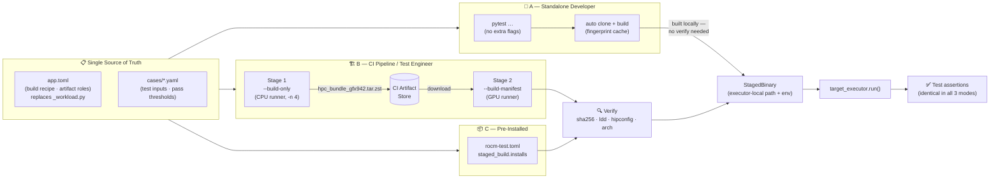
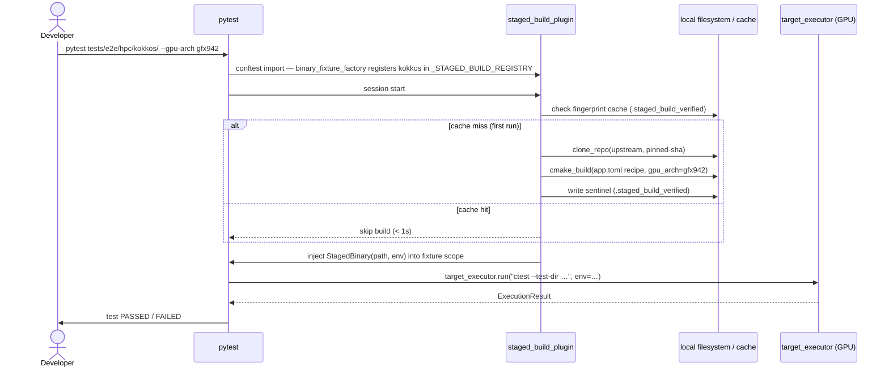
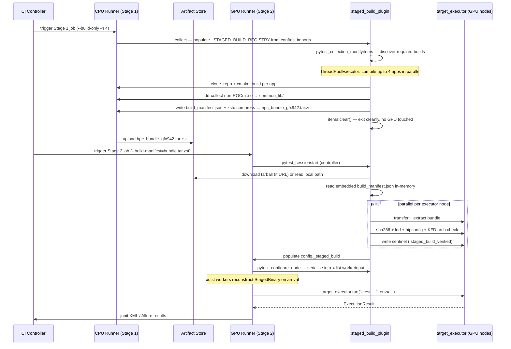
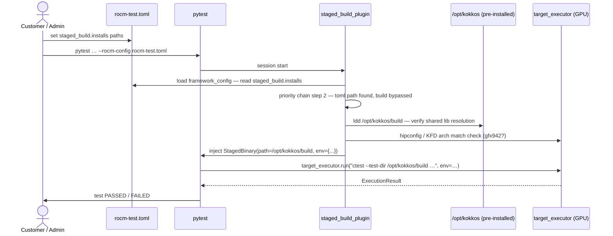

# Staged Build Pipeline — Design and Developer Guide

**Status:** Design RFC · implementation target `framework/plugins/staged_build_plugin.py` (not yet merged)

---

## Executive Summary

HPC applications in the ROCm test suite — Kokkos, rocHPL, QUDA, RAJA, rccl-tests — require
10–30 minutes of CPU-bound compilation before a single GPU test can run. Running that compilation
inside a pytest session on a GPU host wastes expensive hardware, conflates build failures with test
failures, and forces every contributor to re-implement the same clone-cmake-install pattern.

This document describes the **staged build pipeline**: a `pytest` plugin
(`framework/plugins/staged_build_plugin.py`) that decouples compilation from test execution. It
defines a single authoring contract (`app.toml` + `binary_fixture_factory`) that works unchanged
across three distinct usage modes — developer laptop, split CI stages, and pre-installed systems —
so that test code never changes regardless of how the binary arrived.

The document covers who the pipeline is for, how the architecture achieves a single source of
truth, the per-mode workflow with sequence diagrams, and the implementation and authoring details
needed to onboard a new HPC application.

---

## Contents

- [User Personas](#user-personas)
- [High-Level Architecture](#high-level-architecture)
- [Workflow Details](#workflow-details)
- [Implementation Detail](#implementation-detail)
- [Public Entry Points / API](#public-entry-points-api)
- [How to Add a New External Build](#how-to-add-a-new-external-build)
- [Failure Semantics](#failure-semantics)
- [CI Reference Pipeline](#ci-reference-pipeline)
- [Developer Quick-Reference](#developer-quick-reference)

---

## User Personas

HPC applications — Kokkos, rocHPL, QUDA, RAJA, rccl-tests — require 10–30 minutes of CPU-bound
compilation before a single GPU test can run. The staged build pipeline addresses this for three
distinct types of users, each with different goals and constraints.

---

### A — External Developer / Standalone

> **"I cloned the repo. I have ROCm installed. I want to run Kokkos tests."**

An external developer or contributor shouldn't need to know anything about CI pipelines, tarballs, or
`app.toml` schemas. The goal is a single `pytest` command that works out of the box.

On first run the plugin clones the upstream repo, compiles for the target arch, caches the result by
build fingerprint, and immediately runs the tests. On every subsequent run the cache hit is detected
in milliseconds — the developer never waits for compilation again unless the source or toolchain
changes.

**What it solves:**
- No manual `git clone` / `cmake` ritual before tests can run.
- No environment-variable archaeology (`KOKKOS_REF`, `QUDA_SRC_DIR`, ...) across each HPC area.
- Incremental: source-tree fingerprinting skips recompilation when nothing changed.

---

### B — CI Pipeline / Test Engineer / Split Stages

> **"GPU runners are to be used considerately, only for test execution. I need compilation off the
> GPU host and flag build failures out of the test execution stage."**

A CI pipeline / test engineer runs nightly jobs across a GPU fleet. Compilation is CPU-bound and can take
30+ minutes per app — having it happen on GPU hardware means the accelerators sit idle for half the
job. Worse, if a build fails it surfaces as a test failure, inflating the ROCm regression count with
infrastructure noise.

The staged pipeline splits the work into two independent CI stages:

- **Stage 1 (CPU runner):** `--build-only` — clone, compile in parallel, bundle everything into a
  single relocatable tarball, write `build_manifest.json` inside it, exit without touching a GPU.
- **Stage 2 (GPU runner):** `--build-manifest=<tarball>` — extract per executor, verify integrity,
  run the exact same tests.

The `-m` expression is **identical** in both stages. The test file never changes. The plugin absorbs
all mode-switching.

**What it solves:**
- GPU idle time during compilation: eliminated.
- Build failures stay in Stage 1 and never reach Stage 2 test results.
- One tarball per architecture; manifest is embedded inside it — single CI artifact.
- Same test selection filter used in both stages prevents drift between "what was built" and "what
  is tested".

---

### C — Customer / Pre-Installed System

> **"ROCm is already installed at `/opt/rocm`. Kokkos is at `/opt/kokkos`. I want to validate the
> install — not build anything."**

A customer receiving a pre-compiled ROCm distribution, an OEM integrator, or an on-prem admin who
pre-stages HPC libraries before test runs does not want `pytest` touching their production install
or reaching out to GitHub. They have binaries, they want test coverage.

Pre-installed paths are declared in `rocm-test.toml` under `[staged_build.installs]` — no extra
CLI flags required. The existing config cascade (toml → `ROCM_TEST_*` env → CLI) is reused. The
plugin reads these paths at session start, runs the same ldd / hipconfig / KFD arch validators it
would run after extracting a CI bundle, and injects a `StagedBinary` with the declared path. The
test body is unchanged.

**`rocm-test.toml` stanza** — one key per artifact role, keyed as `"<app_id>.<role>"`:

```toml
[staged_build.installs]
"hpc.kokkos.ctest_dir"    = "/opt/kokkos/build"
"hpc.kokkos.install_dir"  = "/opt/kokkos/install"
"hpc.rochpl.bin"          = "/opt/rochpl/bin/xhpl_mpi"
"hpc.quda.ctest_dir"      = "/opt/quda/build"
```

The env-var override form follows the standard `ROCM_TEST_` prefix convention (dots and hyphens
in the key are uppercased and converted to underscores):

```bash
export ROCM_TEST_INSTALL_HPC_KOKKOS_CTEST_DIR=/opt/kokkos/build
export ROCM_TEST_INSTALL_HPC_KOKKOS_INSTALL_DIR=/opt/kokkos/install
```

**What it solves:**
- Zero build overhead; no network access to external repos required.
- Full test coverage against a vendor-supplied or internally pre-staged install.
- Same integrity verification as the CI path — no silent "tests passed on wrong binary" scenarios.
- No new CLI flags; the existing `--rocm-config` path override is enough.

---

### Summary

| Persona | Mode | Config surface |
|---|---|---|
| External developer | Standalone — auto-build + cache | _(none — auto)_ |
| CI pipeline / test engineer | Split stages — build on CPU, run on GPU | `--build-only` / `--build-manifest` CLI flags |
| Customer / pre-installed | Pre-installed — validate without building | `[staged_build.installs]` in `rocm-test.toml` |

---

## High-Level Architecture

All three personas share a **single source of truth**: `app.toml` (build recipe and artifact roles)
and `cases/<app>.yaml` (test inputs and expected results). The data never diverges across modes.

> **Migration note:** Existing HPC tests store workload parameters in `_workload.py` companion
> modules driven by environment variables (e.g. `rochpl/_workload.py`, `quda/_workload.py`).
> During staged build pipeline adoption those modules are replaced by `app.toml` (build recipe)
> and `cases/<app>.yaml` (test-case matrix). `app.toml` becomes the single file an implementer
> edits to onboard or update an HPC application — no scattered env-var archaeology required.



The critical invariant: **the `-m` expression and the test body are identical across all three
flows.** `StagedBinary` absorbs all mode-switching inside the fixture. Test code receives a path
and an env dict — it never sees which mode produced them.

The verify stage (sha256 · ldd · hipconfig · arch) applies only to Persona B and C. Persona A
skips it entirely — the binary was just compiled locally by the same process on the same machine,
so there is nothing to transfer, no integrity risk, and no arch mismatch possible.

---

## Workflow Details

### A — Standalone Developer Workflow

Use this when you have a local GPU and want to run HPC tests from a fresh clone. No CI setup
required. The plugin handles cloning and compilation automatically on the first invocation;
subsequent runs use the fingerprint cache.



**Invocation:**

```bash
# First run — clones and compiles (~20 min for Kokkos):
pytest tests/e2e/hpc/kokkos/ --gpu-arch gfx942 --rock-dir /opt/rocm -v

# Subsequent runs — cache hit, build skipped:
pytest tests/e2e/hpc/kokkos/ --gpu-arch gfx942 --rock-dir /opt/rocm -v
```

---

### B — CI Split-Stage Workflow

Use this in nightly CI where GPU runners are expensive. Stage 1 runs on a cheap high-core CPU
runner and produces a single tarball. Stage 2 runs on the GPU fleet, extracts the tarball per
node, verifies integrity, and runs the tests — zero compilation on GPU hardware.



**Invocation:**

```bash
# Stage 1 — CPU runner, compile + bundle (no GPU needed):
pytest tests/e2e/hpc/ -m "kokkos or rochpl" \
    --build-only \
    --gpu-arch gfx942 \
    --rock-dir /opt/rocm \
    --staging-dir /tmp/hpc_stage \
    -n 4

# Stage 2 — GPU runner, extract + verify + test:
pytest tests/e2e/hpc/ -m "kokkos or rochpl" \
    --build-manifest /tmp/hpc_stage/hpc_bundle_gfx942.tar.zst \
    --rock-dir /opt/rocm \
    -n 4
```

The `-m "kokkos or rochpl"` expression is **identical** in both commands.

---

### C — Pre-Installed / BYO Workflow

Use this when HPC libraries are already compiled and installed on the target system. No network
access, no compilation. The plugin runs the same integrity validators as after a bundle extract,
then hands `StagedBinary` to the test.



**`rocm-test.toml`:**

```toml
[staged_build.installs]
"hpc.kokkos.ctest_dir"   = "/opt/kokkos/build"
"hpc.kokkos.install_dir" = "/opt/kokkos/install"
```

**Invocation — no extra CLI flags beyond pointing at the config:**

```bash
pytest tests/e2e/hpc/kokkos/ \
    --rocm-config /path/to/rocm-test.toml \
    --gpu-arch gfx942 \
    --rock-dir /opt/rocm \
    -v
```

---

## Implementation Detail

### New plugin: `framework/plugins/staged_build_plugin.py`

This is a new plugin registered **after `builder_plugin`** in `conftest.py`'s `pytest_plugins` list.
It does not merge into `builder_plugin.py` — that plugin owns fast, single-file hipcc compilations.
`staged_build_plugin` owns external repo provisioning: clone → CMake/script → bundle → manifest.

**CLI options** (option group `rocm-staged-build`):

| Option | Default | Purpose |
|---|---|---|
| `--build-only` | off | Compile + bundle + write manifest + exit |
| `--build-manifest PATH` | — | Path or URL to tarball or manifest; triggers auto-pull + extract + verify |
| `--staging-dir PATH` | `{compiler_build_dir}/hpc-staging/` | Where to stage compiled binaries |

`--gpu-arch` (from `gpu_plugin`, already registered) is the architecture input — no new `--target-arch`.

**Reused primitives from `framework.builder.binary_builder`** (no changes to that file):

- `clone_repo`, `cmake_build`, `compute_fingerprint`, `source_tree_fingerprint`
- `external_build_lock` — xdist-safe compilation
- `build_cache_action` — skip / incremental / wipe
- `build_artifact_exists`, `assert_binary_exists`
- `detect_mpi_runtime`, `find_rocm_clangpp`

### `app.toml` schema reference

Every field below maps to a key the plugin reads at import time via `load_app_spec`. Required
fields are marked **R**; all others are optional.

#### `[app]` — identity

| Field | Type | Req | Description |
|---|---|---|---|
| `id` | string | **R** | Dot-scoped identifier, e.g. `hpc.kokkos`. Used as the registry key and in `build_manifest.json`. |
| `license` | string | **R** | SPDX expression, e.g. `BSD-3-Clause`. Checked by `assert_license_present`. |

#### `[source]` — upstream repository

| Field | Type | Req | Description |
|---|---|---|---|
| `repo` | string | **R** | HTTPS clone URL. |
| `rev` | string | **R** | Pinned Git ref: a full 40-char SHA or an annotated tag. Branch names are accepted but strongly discouraged — they produce non-reproducible builds. |

#### `[[builds]]` — one entry per build variant (ordered list)

| Field | Type | Req | Description |
|---|---|---|---|
| `name` | string | **R** | Unique within this `app.toml`; referenced by `artifacts[].build` and `depends_on`. |
| `recipe` | string | **R** | `cmake`, `script`, or `make`. See recipe details below. |
| `cmake_args` | list[string] | — | Extra `-DKEY=VALUE` flags. `{gpu_arch}` and `{rock_dir}` are substituted at build time. Only used when `recipe = "cmake"`. |
| `script` | string | — | Path (relative to repo root) of the shell script to run. Required when `recipe = "script"`. |
| `make_args` | list[string] | — | Extra arguments forwarded to `make`. Only used when `recipe = "make"`. |
| `depends_on` | list[string] | — | Names of other `[[builds]]` entries that must complete first. The install prefix of each dependency is injected as a CMake variable `<NAME_UPPER>_PREFIX=<dir>`. |
| `cmake_deps` | list[string] | — | Fixture names (registered in `conftest.py`) whose `StagedBinary.path` is injected as a CMake variable at configure time. |

#### Recipe details

**`cmake`** — calls `cmake -S <src> -B <build_dir>` then `cmake --build`. Automatically
injects `-DROCM_PATH`, `-DCMAKE_PREFIX_PATH`, `-DCMAKE_CXX_COMPILER`, and
`-D{gpu_arch_var}={gpu_arch}`. All `cmake_args` placeholders (`{gpu_arch}`, `{rock_dir}`) are
substituted before the configure step.

**`script`** — executes the named shell script inside the cloned repo root. The following
environment variables are injected automatically; the script must not assume anything beyond them:

| Variable | Value |
|---|---|
| `ROCM_PATH` | Realpath-resolved `rock_dir` |
| `GPU_ARCH` | `--gpu-arch` value (e.g. `gfx942`) |
| `BUILD_DIR` | Absolute path to the output staging directory for this build |
| `INSTALL_DIR` | Same as `BUILD_DIR/install`; script should install artefacts here |
| `<DEP_NAME_UPPER>_PREFIX` | Install prefix of each `depends_on` dependency |

Exit code contract: any non-zero exit aborts the build and is reported as a Stage 1 failure.
The script is responsible for creating `BUILD_DIR` and `INSTALL_DIR` if they do not exist.

**`make`** — runs `make` in the cloned repo root with any `make_args` appended. No compiler
injection; the upstream `Makefile` is used as-is. Use `make_args` to pass `PREFIX=`, `ROCM=`,
or other variables required by the upstream build system.

#### `[artifacts]` — named output roles

Each key is a **role name** (e.g. `ctest_dir`, `install_dir`, `bin`). The value is an inline table:

| Field | Type | Req | Description |
|---|---|---|---|
| `build` | string | **R** | Name of the `[[builds]]` entry that produced this artifact. |
| `path` | string | **R** | Path relative to that build's output directory. `.` means the build directory itself. |
| `probe` | string | — | File or glob that must exist inside `path` after the build; `load_app_spec` raises if absent. E.g. `CTestTestfile.cmake`, `bin/xhpl_mpi`. |

#### `[packages]` — OS dependencies

| Field | Type | Description |
|---|---|---|
| `build` | list[string] | APT package names required during compilation. The plugin auto-installs these (via `os_adapter`) when `--build-only` runs. |
| `runtime` | list[string] | APT packages required on the GPU executor at test time. Installed during Stage 2 bundle extract. |

#### `[fingerprint]` — cache key inputs

| Field | Type | Description |
|---|---|---|
| `extra` | list[string] | Dot-path keys from the fingerprint input table (see [Fingerprint Computation](#fingerprint-computation)) to include in addition to the defaults. E.g. `["toolchain.clang_version", "os.glibc"]`. |

### `_STAGED_BUILD_REGISTRY` — module-level fixture registry

When `binary_fixture_factory` is called at conftest import time it registers:

```python
_STAGED_BUILD_REGISTRY[fixture_name] = (app_toml_path, role)
```

By the time `pytest_collection_modifyitems` runs, all conftest files have been imported and the
registry is complete. The hook intersects `item.fixturenames` with the registry to find which builds
each collected test requires. No `hpc_app` marker — the fixture request is the declaration.

### `StagedBinary` — the fixture return type

```python
class StagedBinary(NamedTuple):
    path: Path          # executor-local absolute path
    env: dict[str, str] # LD_LIBRARY_PATH and other vars, placeholders resolved

    def __str__(self) -> str:    return str(self.path)
    def __fspath__(self) -> str: return str(self.path)
```

`NamedTuple` is used for immutability, hashability, and trivial JSON-serialization for xdist worker
propagation. `path` is **always executor-local** — for SSH tests it points into the extracted bundle
on the remote host, not on the controller.

### `config._staged_build` — generic session registry

```python
config._staged_build: dict[str, dict[str, StagedBinary]]
# e.g. after sessionstart:
config._staged_build = {
    "hpc.kokkos": {
        "ctest_dir": StagedBinary(path=Path("/tmp/staged/.../kokkos/build/"), env={...}),
        "install_dir": StagedBinary(path=Path("/tmp/staged/.../kokkos/install/"), env={...}),
    },
    "rccl.tests": {
        "all_reduce": StagedBinary(path=Path("/tmp/staged/.../rccl-tests/bin/all_reduce_perf"), env={...}),
    },
}
```

### xdist worker propagation

`pytest_sessionstart` runs on the **controller only**. Workers are separate processes that never see
the controller's in-memory state. Without propagation every worker silently falls through to standalone
build mode.

```python
def pytest_configure_node(node):               # controller: runs before each worker starts
    node.workerinput["staged_build"] = {
        app_id: {role: {"path": str(sb.path), "env": sb.env}
                 for role, sb in roles.items()}
        for app_id, roles in node.config._staged_build.items()
    }

def pytest_configure(config):                  # workers: reconstruct on arrival
    raw = getattr(config, "workerinput", {}).get("staged_build")
    if raw:
        config._staged_build = {
            app_id: {role: StagedBinary(Path(v["path"]), v["env"])
                     for role, v in roles.items()}
            for app_id, roles in raw.items()
        }
```

### `FrameworkConfig` extension — `StagedBuildSection`

`staged_build_plugin` reads one new config section: `framework_config.staged_build`. This
requires adding a `StagedBuildSection` dataclass and wiring it into `FrameworkConfig` in
`framework/config/loader.py` following the same pattern used by all existing sections.

**`StagedBuildSection` dataclass** (add to `loader.py`):

```python
@dataclass
class StagedBuildSection:
    """[staged_build] config section — per-app pre-installed path overrides.

    installs: maps "<app_id>.<role>" keys to absolute paths on the local host.
              Used by Persona C (pre-installed) to bypass clone + build entirely.
              Also settable via ROCM_TEST_INSTALL_<APP_ID_UPPER>_<ROLE_UPPER> env vars.
    """
    installs: dict[str, str] = field(default_factory=dict)
```

**`FrameworkConfig` addition** (one new field):

```python
@dataclass
class FrameworkConfig:
    framework:    FrameworkSection    = field(default_factory=FrameworkSection)
    gpu:          GpuSection          = field(default_factory=GpuSection)
    reporting:    ReportingSection    = field(default_factory=ReportingSection)
    therock:      TheRockSection      = field(default_factory=TheRockSection)
    frameworks:   FrameworksSection   = field(default_factory=FrameworksSection)
    staged_build: StagedBuildSection  = field(default_factory=StagedBuildSection)  # NEW
```

**`_build_config` addition** — one extra `_merge` call following the existing pattern:

```python
return FrameworkConfig(
    ...
    staged_build=_merge(StagedBuildSection, "staged_build"),
)
```

**`_apply_env_overrides` addition** — add to `section_map`:

```python
"INSTALL": cfg.staged_build,   # ROCM_TEST_INSTALL_<KEY> → cfg.staged_build.installs[<key>]
```

Because `installs` is a `dict` (not a scalar), the env override logic requires a small
extension: iterate all `ROCM_TEST_INSTALL_*` env vars and populate `cfg.staged_build.installs`
from them, converting the env key suffix back to dot notation
(`ROCM_TEST_INSTALL_HPC_KOKKOS_CTEST_DIR` → `hpc.kokkos.ctest_dir`).

**`rocm-test.toml` stanza** (add to the config reference in this doc and in the toml file):

```toml
[staged_build]
# Per-app pre-installed path overrides (Persona C — no build required).
# Key format:  "<app_id>.<role>"   (e.g. "hpc.kokkos.ctest_dir")
# Value:        absolute path to the artifact on the local host.
# Same keys are settable via ROCM_TEST_INSTALL_<APP_ID_UPPER>_<ROLE_UPPER> env vars.
[staged_build.installs]
# "hpc.kokkos.ctest_dir"   = "/opt/kokkos/build"
# "hpc.kokkos.install_dir" = "/opt/kokkos/install"
# "hpc.rochpl.bin"         = "/opt/rochpl/bin/xhpl_mpi"
```

**Plugin registration order** — append `staged_build_plugin` to `pytest_plugins` in
`conftest.py` **immediately after `builder_plugin`** (currently position 12):

```python
pytest_plugins = [
    "framework.plugins.markers_plugin",    # 1 — MUST be first
    "framework.plugins.session_plugin",    # 2 — MUST be second
    "framework.plugins.gpu_plugin",        # 3
    "framework.plugins.remote_node_plugin",# 4
    "framework.plugins.scheduling_plugin", # 5
    "framework.plugins.executor_plugin",   # 6
    "framework.plugins.os_plugin",         # 7
    "framework.plugins.health_plugin",     # 8
    "framework.plugins.artifacts_plugin",  # 9
    "framework.plugins.prereqs_plugin",    # 10
    "framework.plugins.retry_plugin",      # 11
    "framework.plugins.reports_plugin",    # 12
    "framework.plugins.builder_plugin",    # 13
    "framework.plugins.staged_build_plugin",  # 14 — NEW; must follow builder_plugin
    "framework.plugins.install_plugin",    # 15
]
```

`staged_build_plugin` depends on `framework_config` (from `session_plugin`), `gpu_arch`
(from `gpu_plugin`), and `compiler_build_dir` (from `builder_plugin`) — all three are
already registered before position 14.

### Fingerprint computation

The build fingerprint is a 16-character lowercase hex string produced by
`compute_fingerprint()` in `framework/builder/binary_builder.py`. The function
JSON-encodes a **sorted** list of strings, then returns the first 16 hex chars of
the SHA-256 digest:

```python
# binary_builder.py:1485-1496
def compute_fingerprint(key_inputs: list[str]) -> str:
    content = json.dumps(sorted(str(x) for x in key_inputs))
    return hashlib.sha256(content.encode()).hexdigest()[:16]
```

**Default input set** — these are always included for every app:

| Input key | Value at build time |
|---|---|
| `rev` | Pinned commit SHA from `[source] rev` in `app.toml` |
| `gpu_arch` | `--gpu-arch` value (e.g. `gfx942`) |
| `rock_dir` | Realpath-resolved ROCm install directory |
| `cmake_args` | Sorted, joined `[[builds]] cmake_args` string |

**`extra` inputs** — declared in `[fingerprint] extra` and resolved at build time:

| Key | Resolved value |
|---|---|
| `toolchain.clang_version` | `clang++ --version` first line |
| `os.glibc` | `ldd --version` first line |
| `rocm_version` | `hipconfig --version` output |

The same 16-char digest is written to `<build_dir>/.cmake_fingerprint` as the
`"full"` key alongside a `"structural"` key (computed over `[rev, gpu_arch, rock_dir,
subdir]` only). `build_cache_action` returns `"skip"` when both match, `"incremental"`
when only structural matches, and `"wipe"` when structural diverges.

The same `full` fingerprint is embedded in `build_manifest.json` under
`entries[app_id].fingerprint` and checked during Stage 2 extraction to detect
a bundle built for a different arch or toolchain.

### Parallel compilation (`--build-only -n N`)

Builds are subprocess-bound — the GIL is released during `subprocess.run()`. A
`ThreadPoolExecutor(max_workers=N)` inside `pytest_collection_modifyitems` compiles independent DAG
leaves in parallel. Dependent builds (via `depends_on` in `app.toml`) wait on their prerequisites.
`external_build_lock` serializes access to any shared staging cache key.

### Sentinel file — warm-runner fast path

Before transferring or extracting on any executor, the plugin checks:
```
<extraction_root>/.staged_build_verified
```
If it contains a matching `{fingerprint, rock_dir, gpu_arch}` record, the entire transfer + extraction
+ verification step is skipped for that node. On a warm CI runner or developer machine, Stage 2
startup cost is **one `stat` call per node**.

### Bundle layout

One `--build-only` invocation always produces **one tarball** regardless of how many apps compiled.

`common_lib/` collects shared libraries needed at test runtime that are **not** part of the ROCm
install (`rock_dir/lib`). The plugin runs `ldd` against every binary in every app's output tree
and copies any `.so` whose resolved path does not start with `rock_dir` or a standard system
prefix (`/lib`, `/usr/lib`). When two apps provide a `.so` of the same name, the larger file wins
(a conservative heuristic — prefer the more complete build). Symlinks are resolved to their
targets before copying so the bundle contains only regular files.

```
hpc_bundle_gfx942.tar.zst/
├── build_manifest.json              ← embedded (read in-memory; no full extract needed)
├── common_lib/                      ← merged non-ROCm .so files from ALL apps (ldd-collected)
├── kokkos/
│   ├── build/                       ← ctest_dir role (CTestTestfile.cmake here)
│   └── install/                     ← install_dir role
├── rochpl/bin/xhpl_mpi
├── quda/bin/quda_test
├── rccl-tests/bin/all_reduce_perf
└── logs/
    ├── kokkos_build.log
    └── ...
```

### `build_manifest.json` schema (v1)

```json
{
  "schema_version": 1,
  "target_arch": "gfx942",
  "bundle_path": "hpc_bundle_gfx942.tar.zst",
  "entries": {
    "hpc.kokkos": {
      "app_toml_rel_path": "tests/e2e/hpc/kokkos/app.toml",
      "root": ".",
      "fingerprint": "sha256:9f2c...",
      "fingerprint_inputs": {
        "rev": "<pinned-sha>", "rocm_version": "7.x.y",
        "gpu_arch": "gfx942", "cmake_args": "...",
        "clang_version": "...", "glibc": "2.35"
      },
      "files": [
        { "role": "ctest_dir",  "path": "kokkos/build/",   "sha256": null  },
        { "role": "install_dir","path": "kokkos/install/",  "sha256": null  },
        { "role": "common_lib", "path": "common_lib/",      "sha256": null  }
        // sha256 is null for directory roles — integrity is verified at the
        // bundle level (tarball checksum), not per individual file.
      ],
      "env": {
        "LD_LIBRARY_PATH": ["{root}/common_lib", "{root}/kokkos/install/lib", "{rock_dir}/lib"]
      },
      "packages": {
        "build":   ["git", "g++", "cmake", "ninja-build"],
        "runtime": []
      },
      "provenance": {
        "user_provided": false, "build_host": "ci-cpu-runner-01",
        "created": "2026-11-17T10:00:00Z", "tool": "staged_build_plugin 1.0"
      }
    }
  }
}
```

All file paths are relative to `{root}`; `env` fragments use placeholders resolved on the **executor
host** — the bundle is fully relocatable.

---

## Public Entry Points / API

```python
from framework.plugins.staged_build_plugin import (
    StagedBinary,           # path + env NamedTuple returned by all fixtures;
                            # use as a path string or pass .env to executor.run()
    Case,                   # frozen dataclass: name, label, timeout_s, expected_pass_pct;
                            # returned by load_cases(); use as pytest.fixture params
    load_cases,             # load_cases(app_id) → list[Case]; reads cases/<stem>.yaml
                            # beside the app.toml registered for app_id; replaces _workload.py
    load_app_spec,          # (app_toml_path: Path) → AppSpec; parses app.toml into a
                            # typed dataclass; use in conftest when you need to inspect
                            # the recipe or artifact roles before registering a fixture
    build_app,              # (app_toml_path, role, *, gpu_arch, rock_dir, staging_dir,
                            #  framework_config) → StagedBinary; standalone clone + build;
                            # backing implementation of binary_fixture_factory step 4
    binary_fixture_factory, # PRIMARY AUTHORING SURFACE — call once per artifact role in
                            # conftest.py; returns a session-scoped pytest fixture;
                            # resolves mode via the 4-step priority chain below
)
```

**`AppSpec` dataclass** — returned by `load_app_spec`; mirrors the `app.toml` structure:

```python
@dataclass(frozen=True)
class ArtifactSpec:
    build: str          # name of the [[builds]] entry that produced this artifact
    path: str           # path relative to that build's output directory
    probe: str | None   # file/glob that must exist after build; None = no check

@dataclass(frozen=True)
class AppSpec:
    app_id:             str                      # [app] id
    license:            str                      # [app] license  (SPDX)
    repo:               str                      # [source] repo
    rev:                str                      # [source] rev
    builds:             list[dict]               # [[builds]] entries as parsed dicts
    artifacts:          dict[str, ArtifactSpec]  # role → ArtifactSpec
    packages_build:     list[str]                # [packages] build
    packages_runtime:   list[str]                # [packages] runtime
    fingerprint_extra:  list[str]                # [fingerprint] extra keys
```

`_resolve_from_manifest` is **private** to the plugin. The fixture body calls it internally via
`config._staged_build[app_id][role]`; test code never needs to call it directly.

### `binary_fixture_factory` — mode resolution priority chain

When the session-scoped fixture generated by `binary_fixture_factory` is first requested, it
resolves which binary source to use by walking this chain in order:

```
binary_fixture_factory(app.toml, role="ctest_dir")
         │
         ▼
1. config._staged_build[app_id][role] set?    ← --build-manifest extracted a bundle
   YES → return StagedBinary(bundle path)
         │
         NO
         ▼
2. framework_config.staged_build.installs     ← [staged_build.installs] in rocm-test.toml
   ["hpc.kokkos.ctest_dir"] set?              ← or ROCM_TEST_INSTALL_... env var
   YES → run validators (ldd, arch check)
         return StagedBinary(toml path)        ← clone_repo / cmake_build never called
         │
         NO
         ▼
3. --build-only active?                       ← CI Stage 1
   YES → schedule build; items.clear(); exit
         │
         NO
         ▼
4. standalone (auto-build)                    ← developer local run
   → check fingerprint cache (.cmake_fingerprint)
   → clone_repo + cmake_build if cache miss
   → return StagedBinary(local build path)
```

Steps 1 and 2 are both "already have binaries" fast-paths — the fixture returns a `StagedBinary`
without touching `clone_repo` or `cmake_build`. The test receives the same type from whichever
branch fired and cannot distinguish which one did.

---

## How to Add a New External Build

Adding a new HPC app or any external project (rccl-tests, QUDA, rocm-examples) that follows
clone → build → binary requires three files.

### Step 1: Create `app.toml` beside the test area's `conftest.py`

```toml
# tests/e2e/hpc/myhpc/app.toml
[app]
id = "hpc.myhpc"
license = "Apache-2.0"

[source]
repo = "https://github.com/owner/myhpc"
rev = "<pinned-sha>"                      # pin to a known-good commit

[[builds]]
name = "hip"
recipe = "cmake"
cmake_args = [
    "-DENABLE_HIP=ON",
    "-DAMDGPU_TARGETS={gpu_arch}",        # {gpu_arch} is substituted at build time
]

[artifacts]
ctest_dir = { build = "hip", path = ".", probe = "CTestTestfile.cmake" }

[packages]
build   = ["git", "cmake", "g++"]
runtime = []

[fingerprint]
extra = ["toolchain.clang_version", "os.glibc"]
```

**Recipes available:** `cmake` (most common), `script` (e.g. rocHPL's `install.sh`), `make`.

**Multiple build flavours** in one `app.toml` — use `depends_on` to order them:

```toml
[[builds]]
name = "cpu"
recipe = "cmake"
cmake_args = ["-DENABLE_OPENMP=ON"]

[[builds]]
name = "hip"
recipe = "cmake"
depends_on = ["cpu"]     # cpu builds first; its install dir injected as -DCPU_PREFIX=<dir>
cmake_args = ["-DENABLE_HIP=ON"]
```

**Cross-repo dependency** — when a test needs two separate repos:

```toml
# tests/e2e/hpc/myhpc/app.toml
[[builds]]
name = "hip"
cmake_deps = ["fftw_lib"]   # fixture name registered in conftest; install dir injected at cmake time
cmake_args = ["-DPKG_FFTW=ON"]
```

```python
# tests/e2e/hpc/myhpc/conftest.py
fftw_lib   = binary_fixture_factory(Path(__file__).parent.parent / "deps/fftw.toml", role="lib")
myhpc_bin  = binary_fixture_factory(Path(__file__).parent / "app.toml", role="gpu_bin")
```

### Step 2: Declare the fixture in `conftest.py`

```python
# tests/e2e/hpc/myhpc/conftest.py
from pathlib import Path
from framework.plugins.staged_build_plugin import binary_fixture_factory

# Returns a session-scoped fixture. Mode is selected automatically:
#   --build-manifest  → resolve from pre-built bundle
#   --build-only      → compile + bundle + exit (fixture not called by tests)
#   standalone        → clone + build locally on first run, cached by fingerprint
#   [staged_build.installs] in toml → resolve pre-installed path, run validators only
myhpc_binary = binary_fixture_factory(Path(__file__).parent / "app.toml", role="ctest_dir")
```

For areas that expose multiple roles (build dir + install prefix):

```python
myhpc_build_dir   = binary_fixture_factory(Path(__file__).parent / "app.toml", role="ctest_dir")
myhpc_install_dir = binary_fixture_factory(Path(__file__).parent / "app.toml", role="install_dir")
```

### Step 3: Write the test file

```python
# tests/e2e/hpc/myhpc/test_myhpc.py
import pytest


@pytest.mark.hw.gpu
@pytest.mark.ci.nightly
@pytest.mark.layer.runtime
@pytest.mark.runtime.medium
def test_myhpc_correctness(myhpc_binary, target_executor):
    """Run myhpc ctest suite and verify all tests pass."""
    # myhpc_binary is StagedBinary — f"{myhpc_binary}" gives the executor-local path string.
    # myhpc_binary.env carries LD_LIBRARY_PATH pre-resolved to the bundle root on this executor.
    result = target_executor.run(
        f"ctest --test-dir {myhpc_binary} --output-on-failure",
        env=myhpc_binary.env,
    )
    assert result.ok, result.stderr[-2000:]
    assert "100% tests passed" in result.stdout
```

**The test body is identical in all three modes** — standalone, `--build-only`, and `--build-manifest`.
The fixture absorbs all mode-switching; the test just receives a `StagedBinary`.

### Step 4: Add a case catalogue

The case catalogue is **required** for any test area that runs more than one ctest label or
workload variant. It is the `cases/<app>.yaml` half of the SSOT and replaces the per-area
`_workload.py` + environment-variable pattern used by the existing HPC tests.

**`cases/<app>.yaml` format:**

```yaml
# tests/e2e/hpc/myhpc/cases/myhpc.yaml
defaults:
  timeout_s: 1200
  expected_pass_pct: 100
cases:
  unit_tests:
    label: "UnitTest"
    timeout_s: 600
  performance_tests:
    label: "PerformanceTest"
    timeout_s: 1800
    expected_pass_pct: 90   # case-level override wins over defaults
```

**`Case` dataclass** — returned by `load_cases`; fields are merged from `defaults` + case entry:

```python
@dataclass(frozen=True)
class Case:
    name: str              # dict key under cases: (e.g. "unit_tests")
    label: str             # ctest -L selector string
    timeout_s: float       # wall-clock limit passed to executor.run()
    expected_pass_pct: int # minimum passing percentage; 100 = all must pass
```

**`load_cases(app_id)` function** — reads `cases/<stem>.yaml` relative to the `app.toml` that
registered `app_id`, merges `defaults` into every case entry, and returns a list of `Case`
objects in YAML definition order:

```python
def load_cases(app_id: str) -> list[Case]:
    """Return the parametrize list for app_id from its cases/<stem>.yaml.

    Args:
        app_id: Dot-scoped app identifier matching [app] id in app.toml
                (e.g. "hpc.myhpc").

    Returns:
        Ordered list of Case objects with defaults merged in.

    Raises:
        FileNotFoundError: cases YAML not found beside the registered app.toml.
        KeyError: a case entry is missing a required field not covered by defaults.
    """
```

**Usage in test file:**

```python
import re
import pytest
from framework.plugins.staged_build_plugin import load_cases


@pytest.fixture(params=load_cases("hpc.myhpc"), ids=lambda c: c.name)
def case(request):
    return request.param


@pytest.mark.hw.gpu
@pytest.mark.ci.nightly
@pytest.mark.layer.runtime
@pytest.mark.runtime.medium
def test_myhpc_ctest(case, myhpc_binary, target_executor):
    result = target_executor.run(
        f"ctest --test-dir {myhpc_binary} -L {case.label} --output-on-failure",
        env=myhpc_binary.env,
        timeout=case.timeout_s,
    )
    assert result.ok, result.stderr[-2000:]
    passed_pct = int(re.search(r"(\d+)% tests passed", result.stdout).group(1))
    assert passed_pct >= case.expected_pass_pct
```

**Migration from `_workload.py`:** convert the existing variant dict (e.g. `ASIC_MATRIX` in
`rochpl/_workload.py`) to a `cases/<app>.yaml`, replace `pytest_generate_tests` with a
`@pytest.fixture(params=load_cases(...))` fixture, and delete `_workload.py`. The env-var JSON
override (`ROCHPL_MATRIX_JSON`) is superseded — runtime case-matrix overrides are achieved by
replacing the `cases/<app>.yaml` file before the run.

---

## Failure Semantics

| Failure point | Reported as | Effect on ROCm pass rate |
|---|---|---|
| Clone or compile error | CI Stage 1 job failure; dependent tests `skip` or `error` (strict mode) | None |
| Bundle / compression failure | CI Stage 1 job failure | None |
| Hash, ldd, or arch verification failure | `pytest.exit()` — session aborted, rc=3 | None |
| Test assertion failure | Test `FAILED` | Counted |

Build failures never read as ROCm regressions. The separation is enforced by the two-stage pipeline.

### Verification failure details

Integrity verification runs in `pytest_sessionstart` on the **controller process**, before any
worker or test starts. If any check fails the session is aborted immediately via `pytest.exit()`
with return code 3 — the same convention used by `prereqs_plugin` for hard session failures.

```
FATAL [staged_build] Bundle verification failed — session aborted.

  Node: gpu-node-01
  App:  hpc.kokkos
  Check: sha256
  Expected: 9f2c1a3b...  Got: deadbeef...

Fix: re-download the bundle or re-run --build-only to regenerate it.
```

The three checks that run per executor node, in order:

1. **sha256** — the tarball checksum recorded in `build_manifest.json` is recomputed on the
   executor after transfer. A mismatch means a corrupted or partial download.
2. **ldd** — `ldd` is run against each binary in the extracted bundle. Any `not found` line
   aborts with the full `ldd` output attached. This catches a missing runtime library that would
   otherwise cause a silent test-time `SIGSEGV`.
3. **arch** — `hipconfig --amdgpu_target` is compared against `target_arch` in
   `build_manifest.json`. A mismatch (e.g. bundle built for `gfx942`, runner has `gfx1100`)
   aborts with an explicit message rather than producing silent wrong-arch results.

No check produces a test `ERROR` outcome. The philosophy follows `install_plugin`
(`returncode=4`) and `prereqs_plugin` (`returncode=3`): infrastructure defects abort the session
cleanly so they appear as a CI stage failure, not as a ROCm regression in the test results.

---

## CI Reference Pipeline

Stage 1 and Stage 2 run on **different runners** — a CPU host and a GPU host respectively. The
only connection between them is the tarball uploaded as a CI artifact at the end of Stage 1 and
downloaded automatically by the CI system before Stage 2 begins. There is no shared filesystem.

```yaml
# .github/workflows/e2e-nightly.yml  (staged HPC build/test jobs)
name: HPC Staged Build and Test

on:
  schedule:
    - cron: '0 3 * * *'          # UTC 03:00 nightly
  workflow_dispatch:
    inputs:
      gpu_arch:
        description: 'Target GPU architecture (e.g. gfx942)'
        required: false
        default: 'gfx942'

jobs:
  # ─────────────────────────────────────────────────────────────
  # JOB 1 — CPU runner (no GPU, cheap high-core host)
  # Compiles all apps, bundles them, then uploads the tarball
  # as a GitHub Actions artifact. No GPU is touched.
  # ─────────────────────────────────────────────────────────────
  compile-hpc-apps:
    runs-on: [self-hosted, cpu-high-core]
    container:
      image: rocm/dev-ubuntu-22.04:6.2
    steps:
      - uses: actions/checkout@v4

      - name: Compile and bundle HPC apps
        env:
          TARGET_GFX: ${{ inputs.gpu_arch || 'gfx942' }}
        run: |
          pytest tests/e2e/hpc/ -m "kokkos or rochpl" \
            --build-only \
            --gpu-arch=$TARGET_GFX \
            --rock-dir=$ROCK_DIR \
            --staging-dir=/tmp/hpc_stage \
            -n 4
          # ↑ produces /tmp/hpc_stage/hpc_bundle_${TARGET_GFX}.tar.zst
          # manifest is embedded inside the tarball — single artifact upload

      - name: Upload HPC bundle
        uses: actions/upload-artifact@v4
        with:
          name: hpc-bundle-${{ inputs.gpu_arch || 'gfx942' }}
          path: /tmp/hpc_stage/hpc_bundle_${{ inputs.gpu_arch || 'gfx942' }}.tar.zst
          retention-days: 1

  # ─────────────────────────────────────────────────────────────
  # JOB 2 — GPU runner (different host, different filesystem)
  # actions/download-artifact fetches the bundle from Job 1
  # before the test step runs. The plugin reads the tarball,
  # extracts per executor node, verifies integrity, then runs
  # tests — zero compilation on GPU hardware.
  # ─────────────────────────────────────────────────────────────
  test-hpc:
    runs-on: [self-hosted, gpu-runner]
    needs: compile-hpc-apps
    steps:
      - uses: actions/checkout@v4

      - name: Download HPC bundle
        uses: actions/download-artifact@v4
        with:
          name: hpc-bundle-${{ inputs.gpu_arch || 'gfx942' }}
          path: /tmp/hpc_stage
          # ↑ GitHub Actions downloads the artifact automatically before this step

      - name: Run HPC tests
        env:
          TARGET_GFX: ${{ inputs.gpu_arch || 'gfx942' }}
        run: |
          pytest tests/e2e/hpc/ -m "kokkos or rochpl" \
            --build-manifest=/tmp/hpc_stage/hpc_bundle_$TARGET_GFX.tar.zst \
            --rock-dir=$ROCK_DIR \
            --junitxml=results.xml \
            -n 4
          # ↑ --build-manifest points at the downloaded artifact path, not a shared volume

      - name: Upload test results
        uses: actions/upload-artifact@v4
        if: always()
        with:
          name: hpc-test-results-${{ inputs.gpu_arch || 'gfx942' }}
          path: results.xml
```

**Key properties:**
- `-m "kokkos or rochpl"` is **identical** in both jobs — same test selection, same SSOT.
- The tarball travels via `actions/upload-artifact` / `actions/download-artifact`; the two jobs share no filesystem.
- Stage 2 never calls `tar`, never sets `LD_LIBRARY_PATH` — the plugin handles both.
- Build failures appear only in `compile-hpc-apps` and never reach `test-hpc` results.

---

## Developer Quick-Reference

```bash
# Standalone (auto-build on first run; cached after):
pytest tests/e2e/hpc/kokkos/ --gpu-arch gfx942 --rock-dir /opt/rocm -v

# Stage 1 — build and bundle on a CPU host (no GPU needed):
#   produces /tmp/hpc_stage/hpc_bundle_gfx942.tar.zst
#   upload this tarball to your CI artifact store / NFS / S3
pytest tests/e2e/hpc/ -m "kokkos or rochpl" \
    --build-only --gpu-arch gfx942 --rock-dir /opt/rocm \
    --staging-dir /tmp/hpc_stage -n 4

# Stage 2 — on a different GPU host, download the artifact first, then run:
#   --build-manifest accepts a local path (after download) or a direct URL
pytest tests/e2e/hpc/ -m "kokkos or rochpl" \
    --build-manifest /path/to/downloaded/hpc_bundle_gfx942.tar.zst \
    --rock-dir /opt/rocm -n 4

# Pre-installed: declare paths in rocm-test.toml, no build flags needed:
pytest tests/e2e/hpc/kokkos/ \
    --rocm-config /path/to/rocm-test.toml \
    --gpu-arch gfx942 --rock-dir /opt/rocm -v

# Preview what --build-only would compile (collect only, no build):
pytest tests/e2e/hpc/ -m "kokkos or rochpl" --build-only --collect-only -q --no-gpu
```
