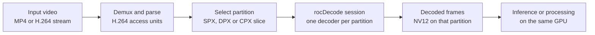

# rocdecode_one_stream_per_gpu

## Use case

An application assigns one H.264 stream to each partition. Each stream must decode on its partition, and its engine time must stay on that partition's render node. Frame count alone can pass while streams share an engine, so the check uses engine time.

Type : Functional

- **SPX:** one GPU per card.
- **DPX:** two halves per card (P0, P1).
- **CPX:** eight slices per card (P0–P7). P0/P1, P2/P3, P4/P5, and P6/P7 share an engine.

Run the program that matches the host mode. Input is `data/sample_stream.h264`.

| Program | Host mode | Partitions per card |
|---|---|---|
| `rocdecode_spx_one_stream_per_card` | SPX | 1 (P0) |
| `rocdecode_dpx_one_stream_per_half` | DPX | 2 (P0, P1) |
| `rocdecode_cpx_one_stream_per_slice` | CPX | 8 (P0–P7) |

Exit code 0 is pass, 1 is fail, and 2 is skip. A skip is not a pass. Skip when no GPU is present, the host is in a different mode, or every card has four slices.

### Application flow



The test replaces the MP4 demux step with a raw H.264 file, `data/sample_stream.h264`. The check covers steps C and D, so the frames and engine time it reports come from the partition that was selected.

## Pair time and other time

Each decode row shows:

| Column | Meaning |
|---|---|
| `own nodes` | Render nodes of the row's partitions, e.g. `D128/D129` for P0–P1. |
| `pair time` | Engine time (ms) the row's sessions added on their own nodes. |
| `other time` | Engine time other sessions added on those nodes. |

Times come from the `drm-engine-*` counters, read before and after each session. In `--xcd all`, a row is a pair (P0–P1, P2–P3, P4–P5, P6–P7). With an explicit `--xcd` list, a row is one partition.

Failures: "no own-node time" (nothing on the row's own nodes) and "node also carries Pn" (another session has time on those nodes).

If the per-session counters read zero but the node counter shows time, that time is split between sessions by count. The decode block then says `split by session count`, and `pair time` and `other time` are estimates. The pass decision does not change.

## Set the ROCm path

If ROCm is installed at `/opt/rocm`, nothing needs to be set. The build and the run use `/opt/rocm` by default.

To use a different ROCm tree, set `ROCM_PATH` to that tree before configure, build, and run:

```
export ROCM_PATH=<path-to-rocm>
```

The build reads `ROCM_PATH` at configure time, and the program reads it at run time for the ROCm version in the header and for `amd-smi`. CMake records the tree's library directories in the program, so `LD_LIBRARY_PATH` and `PATH` do not need to change.

To return to the default, set it back to `/opt/rocm`:

```
export ROCM_PATH=/opt/rocm
```

`<path-to-rocm>` is the directory that contains `bin/hipcc`, `lib/librocdecode.so`, and `.info/version`.

## Build

From this directory:

```
cmake -S . -B build
cmake --build build
```

This produces:

```
./build/rocdecode_spx_one_stream_per_card
./build/rocdecode_dpx_one_stream_per_half
./build/rocdecode_cpx_one_stream_per_slice
```

`xcd_burn` is built next to them and is used only by `smi_one_xcd`.

## Run

Match the program to the host mode.

```
./build/rocdecode_spx_one_stream_per_card
./build/rocdecode_dpx_one_stream_per_half
./build/rocdecode_cpx_one_stream_per_slice
```

Each command runs `partition_layout`, then the decode check. To run one check:

```
./build/rocdecode_cpx_one_stream_per_slice partition_layout
./build/rocdecode_cpx_one_stream_per_slice cpx_one_stream_per_slice
```

On CPX, a named subtest runs only that decode. The name is `rocdecode_cpx_one_stream_per_slice_` plus the XCD command, with commas written as underscores.

| Subtest | Same as |
|---|---|
| `rocdecode_cpx_one_stream_per_slice_xcd_all` | `--xcd all` |
| `rocdecode_cpx_one_stream_per_slice_xcd_one` | `--xcd one` |
| `rocdecode_cpx_one_stream_per_slice_xcd_0` … `_xcd_7` | `--xcd 0` … `--xcd 7` |
| `rocdecode_cpx_one_stream_per_slice_xcd_0_1` | `--xcd 0,1` |
| `rocdecode_cpx_one_stream_per_slice_xcd_0_2` | `--xcd 0,2` |
| `rocdecode_cpx_one_stream_per_slice_xcd_0_3` | `--xcd 0,3` |
| `rocdecode_cpx_one_stream_per_slice_xcd_3_0` | `--xcd 3,0` |
| `rocdecode_cpx_one_stream_per_slice_xcd_7_6_5_4_3_2_1_0` | `--xcd 7,6,5,4,3,2,1,0` |

```
./build/rocdecode_cpx_one_stream_per_slice rocdecode_cpx_one_stream_per_slice_xcd_0
./build/rocdecode_cpx_one_stream_per_slice rocdecode_cpx_one_stream_per_slice_xcd_0_3
```

`--xcd all` plays P0–P7 and scores neighboring pairs. `--xcd one` or `--xcd N` plays that one XCD on every card. `--xcd 3,0` plays those XCDs in that order and scores each on its own row. `--xcd` selects by PCI function.

Other flags, unchanged by the subtest name:

```
./build/rocdecode_cpx_one_stream_per_slice --xcd 0,3 --keep-decoder
./build/rocdecode_cpx_one_stream_per_slice --xcd 3,0 --parallel
./build/rocdecode_cpx_one_stream_per_slice --sequence 0c:0,15:3
./build/rocdecode_cpx_one_stream_per_slice --xcd 2 smi_one_xcd
```

`--keep-decoder` leaves each decoder open until every selected session is created. `--parallel` creates the selected sessions on one card at the same time. `--touch-all` opens every partition with HIP before decode. `--sequence 0c:0,15:3` plays only those card and XCD steps (`0c` matches `0000:0c:00`). `--allow-partial` decodes when `ROCR_VISIBLE_DEVICES` hides partitions. `--verbose`, `--json`, and `--csv` change the report. `--help` prints the full list.

## PASS / FAIL

A row passes when every partition maps to a render node, every session shows at least one frame, its own nodes show engine time, and no other session adds time on those nodes. A row fails on no frame, no matching node, zero own-node time, or time on another partition's node.

| Program | Check | Pass |
|---|---|---|
| SPX | `partition_layout` | 1 partition per card |
| SPX | `spx_one_stream_per_card` | Stream shows frames; time only on the card's node |
| DPX | `partition_layout` | 2 partitions per card |
| DPX | `dpx_one_stream_per_half` | Each half shows frames; time only on its own node |
| CPX | `partition_layout` | 8 partitions per card |
| CPX | `cpx_one_stream_per_slice` | Each slice shows frames; each pair's time comes only from that pair |

`smi_one_xcd` is optional and runs only when named.
